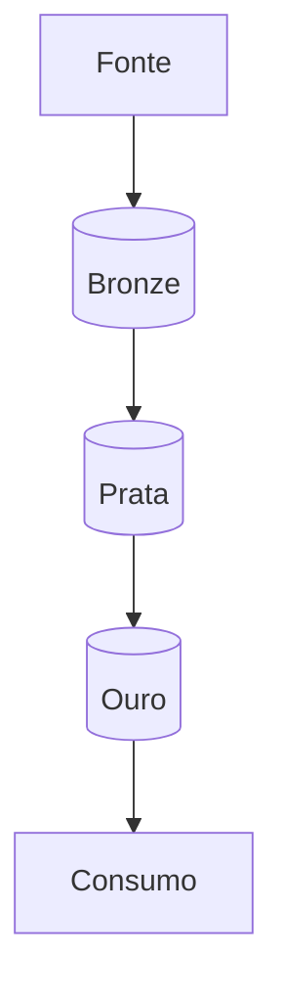

# Nome do projeto

Uma frase: o que o projeto faz, para quem, com que dados.


**Site:** https://... · **Estudo de caso:** https://gabrielcesanto.github.io/projetos/<nome>

## Por que existe

O problema em 3–5 linhas, com números (volume, tempo gasto antes, quem usa).

## Arquitetura



| Pasta | O que tem |
|---|---|
| `pipeline/` | extração e camadas |
| `tests/` | testes de código e de dados |
| `docs/` | arquitetura, decisões, dicionário de dados |

Detalhes e o porquê de cada escolha: [`docs/ARQUITETURA.md`](docs/ARQUITETURA.md) e
[`docs/decisoes/`](docs/decisoes/).

## Como rodar

```bash
git clone https://github.com/GabrielCESanto/<repo>.git
cd <repo>
py -m venv .venv && .venv\Scripts\activate
pip install -r requirements.txt
py -m pipeline.executar --amostra      # roda com uma amostra pequena em poucos minutos
```

Requisitos, variáveis de ambiente (`.env.example`) e tempo esperado de cada etapa.

## Dados

| Camada | Arquivos | Linhas | Tamanho | Atualização |
|---|---|---|---|---|
| bronze | | | | |
| prata | | | | |
| ouro | | | | |

Fonte, licença dos dados e decisões de privacidade (LGPD), se houver dado pessoal.

## Qualidade

- Referência externa usada para validar e tolerância aceita.
- Testes automatizados: `pytest` (código) e checagens de dados (contagem, unicidade, domínio, nulos).
- O que acontece quando a validação falha.

## Limitações conhecidas

- Liste aqui. Um projeto sem limitações escritas ainda não foi testado o bastante.

## Licença

MIT (código). Dados: licença da fonte original.
