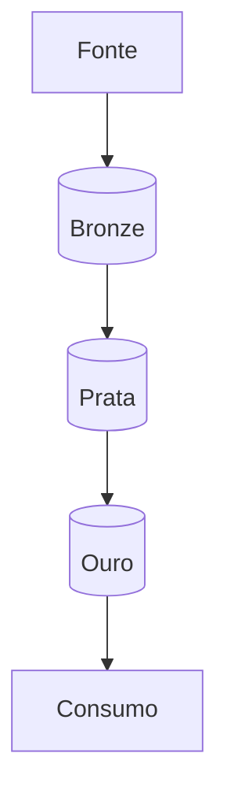

---
# Copie para src/content/projetos/<nome>.md. O nome do arquivo vira a URL.
titulo: Nome do projeto
resumo: Uma ou duas frases com o problema e o resultado. Aparece no card e no topo da página.
area: engenharia            # engenharia | ciencia | bi | backend | ia
papel: Autor (projeto individual)
periodo: '2026'             # sempre entre aspas
stack: [Python, DuckDB, Parquet]
metricas:                   # 4 números, com unidade
  - { valor: '0 mi', rotulo: 'linhas processadas' }
  - { valor: '0%', rotulo: 'de redução de tempo' }
  - { valor: '0', rotulo: 'fontes integradas' }
  - { valor: '± 0%', rotulo: 'diferença para a fonte oficial' }
links:                      # só repositórios PÚBLICOS; omita se o código for privado
  # repo: https://github.com/GabrielCESanto/repo
  # site: https://...
icones: [banco, fluxo, barras] # capa do card: 1 principal + até 2 (lista em src/components/icones.ts)
# selo: TCC                 # etiqueta opcional na capa
ordem: 10
destaque: false
rascunho: true              # mude para false quando estiver pronto
---

## Contexto

Quem tinha o problema, como era feito antes e por que isso importava. 2 parágrafos.

## O problema de dados

Lista curta com o que tornava o problema difícil: volume, fonte sem chave, API lenta, privacidade,
dado sujo. Use números.

## Arquitetura

Uma tabela ou parágrafo explicando cada camada: o que entra, o que sai e onde fica.

## Decisões técnicas

| Decisão | Alternativa descartada | Por quê |
|---|---|---|
| | | |

## Qualidade e validação

Como você sabe que o número está certo: referência externa, tolerância, testes, o que acontece
quando falha. Inclua bugs que você encontrou (na fonte ou em sistemas anteriores).

## Resultados

Impacto em números e o que passou a ser possível.

## O que eu faria diferente / próximos passos

Mostra maturidade. 2 a 3 itens.
