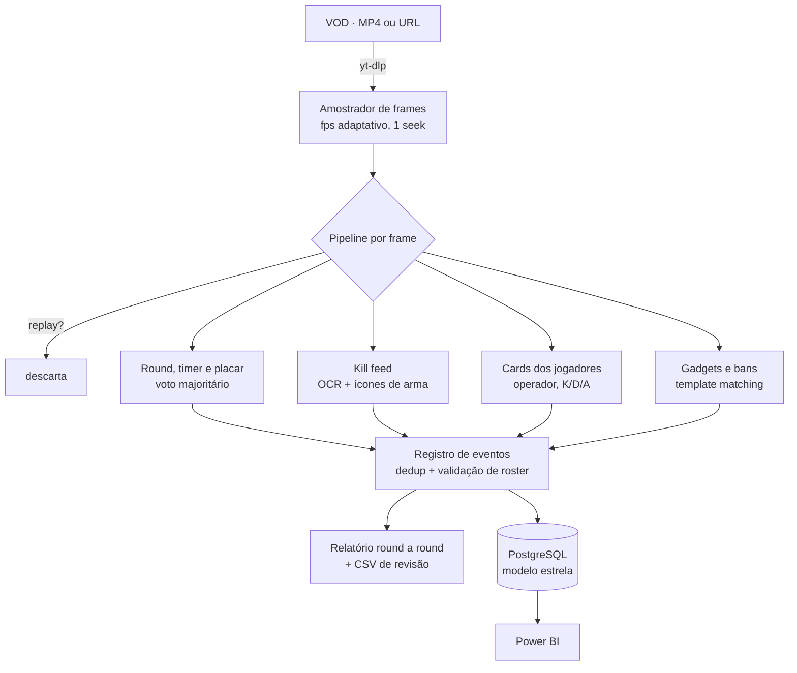

## Contexto

O cenário competitivo brasileiro de Rainbow Six Siege não tem uma base pública de estatísticas por
round: quem matou quem, com qual arma, quais operadores foram banidos, quais gadgets foram usados.
Esses dados existem só na tela, no HUD das transmissões.

O projeto começou como um Power BI alimentado à mão e evoluiu para um **pipeline de visão
computacional** que assiste ao VOD e extrai os eventos sozinho.

## Modelo de dados

O destino dos eventos é um **modelo estrela** (Kimball): fatos no grão de partida, mapa, round, kill e
desempenho do jogador por round, com dimensões de jogador, time, organização, operador, arma e mapa.
A `bridge_team_roster` guarda o histórico de escalação com `date_in`/`date_out`, uma dimensão que
muda com o tempo.

## Arquitetura do pipeline

**Amostragem adaptativa.** Decodificar o vídeo inteiro a 30 fps é inviável, e uma taxa fixa baixa
perde kills. A taxa do próximo frame depende do estado do jogo:

| Situação | Taxa |
|---|---|
| Sem timer na tela, replay | 0,1 fps |
| Ação, de 2:59 a 1:00 | 2 fps |
| Ação, de 0:58 a 0:11 | 3 fps |
| Últimos 10 segundos | 5 fps |

Ao detectar a faixa "WON ROUND", o pipeline relê **todos** os frames dos 6 segundos anteriores: a kill
que fecha o round às vezes fica legível por só 3 frames.

## Qualidade: gabarito manual e regressão

A validação é feita contra um **gabarito**: assisto ao VOD, anoto o que aconteceu e comparo com o
relatório. Cada divergência vira uma investigação de causa raiz, uma correção e um **caso de
regressão** com o frame real como fixture. Alguns exemplos:

- **Tela de pausa técnica** fazia o placar ser lido sem timer. O voto majoritário derivava "round 8"
  no início da partida e travava. Correção: placar e round só valem quando o timer está legível no
  mesmo frame.
- **Câmera de drone ao vivo** escurece a tela como um replay. O pipeline baixava a amostragem e perdia
  uma kill. Correção: o detector de replay passou a exigir o ícone central do replay.
- **Nomes de OCR-lixo fossilizados** no corretor de roster deixavam passar kills fantasmas. Lição
  registrada: uma correção que só cobre a fonte *vazia* não cobre a fonte *corrompida*.

## Resultados

- 10 partidas profissionais processadas em lote (45 a 110 min por VOD, em GPU).
- Relatório round a round com kills, headshots, bans, gadgets e conciliação entre o card oficial e o
  kill feed.
- Dashboard em Power BI com ranking de jogadores (K/D, KOST, KPR), mapas e operadores mais escolhidos
  e vitórias por lado. [Ver o dashboard](/dashboards#data-siege).

## Próximos passos

- Trocar parte do template matching por **detecção supervisionada (YOLO)**, começando pelos gadgets,
  usando os gabaritos como dataset rotulado.
