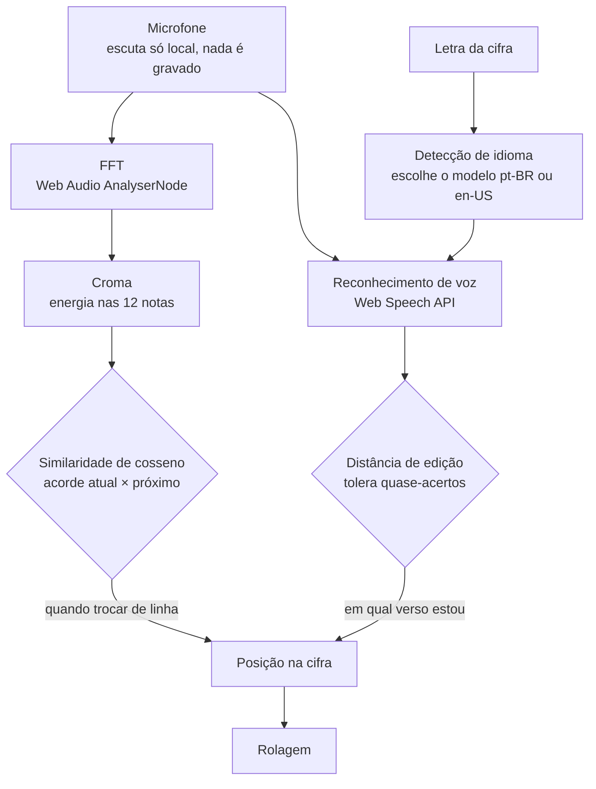
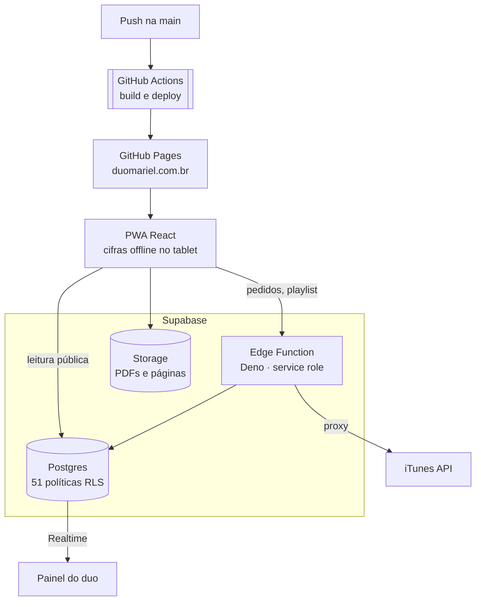

## Contexto

Toco num duo de voz e violão. Nos shows, o público pedia música em papel ou no grito, e as cifras
ficavam em PDFs espalhados num tablet. Queria um site em que o público consulta o repertório e pede
pelo celular, e em que nós recebemos os pedidos ao vivo e abrimos a cifra no palco, mesmo sem
internet.

O site está no ar em [duomariel.com.br](https://duomariel.com.br) e é usado nos shows. Foi
construído de julho a outubro de 2026 **com IA como par de programação**. Esse é o foco deste estudo
de caso: o que a IA acelerou, onde a responsabilidade continuou sendo minha e quais recursos de IA
e processamento de sinal rodam dentro do próprio site.

## Como usei IA no desenvolvimento

**108 commits em 3 meses; 76 deles (70%) escritos em par com o Claude Code.** A divisão de papéis
foi clara:

| Eu | A IA |
|---|---|
| Definir o problema, o escopo de cada entrega e os critérios de pronto | Propor a implementação e escrever a maior parte do código |
| Decidir a arquitetura, o modelo de dados e as regras de segurança | Gerar migrações SQL, políticas e funções a partir dessas decisões |
| Testar no ambiente real (tablet no palco, celular do público) | Corrigir a partir do erro reproduzido |
| Revisar cada mudança antes do commit | Documentar o código e o README |

O ciclo de cada funcionalidade: **especificar → IA implementa → testo no uso real → reporto o que
falhou com evidência → corrige → commit**. A IA acelera a escrita; o que garante a qualidade é o
teste no contexto real e a revisão.

### Guarda-corpos: não confiar no código gerado onde importa

- **Segurança no banco, não no front.** Todas as regras de acesso estão em Row Level Security no
  Postgres (51 políticas). Mesmo que um trecho gerado no front tenha um erro, o banco não deixa um visitante alterar
  dados. Só os dois usuários do duo existem e o cadastro público está desligado.
- **Chave privilegiada só no servidor.** A `service role` do Supabase vive apenas na Edge Function e
  nos secrets do GitHub, nunca no repositório nem no navegador.
- **Scripts destrutivos simulam por padrão.** As ferramentas Python que gravam no banco em lote só
  aplicam com `--aplicar`; sem isso, mostram o que fariam.
- **Esquema por migrações versionadas**, revisadas como código, em vez de alterações pelo painel.

## IA e processamento de sinal dentro do site

### Rolagem que acompanha a música

O modo experimental de acompanhamento rola a cifra conforme a música é tocada e cantada, combinando
dois sinais:

- **Acordes:** em vez de reconhecer qualquer acorde, o que é difícil e instável, o modelo compara o
  som só com o acorde que a cifra espera agora e com o próximo. Como a sequência já é conhecida, a
  pergunta vira "qual dos dois?", muito mais confiável.
- **Voz:** quando o mesmo acorde se repete em vários versos, o áudio não sabe em qual repetição o
  músico está. A letra cantada resolve isso, com distância de Levenshtein para tolerar plural,
  conjugação e pequenas diferenças.
- **Idioma:** o reconhecedor precisa saber o idioma de antemão. Uma contagem de palavras
  características escolhe pt-BR ou en-US para cada música.

### Outros recursos

- **Afinador** pelo microfone, com detecção de frequência fundamental (McLeod Pitch Method).
- **Conversão de cifra em PDF para texto** (ChordPro) no navegador, o que habilita transposição de
  tom e capotraste. Para PDFs escaneados ou com fonte quebrada, um pipeline em Python com **OCR
  (Tesseract)** converte o acervo em lote.

## Arquitetura e infraestrutura

| Peça | Escolha | Por quê |
|---|---|---|
| Hospedagem | GitHub Pages + domínio próprio | Grátis, HTTPS automático e deploy a cada push |
| Banco | Postgres no Supabase, 8 migrações versionadas | SQL de verdade, RLS, Auth, Storage e Realtime no mesmo serviço, plano gratuito |
| Escrita pública | Edge Function em Deno | Pedidos e playlist de evento (protegida por senha) passam por validação no servidor; o navegador nunca escreve direto nas tabelas sensíveis |
| Tempo real | Supabase Realtime na tabela `pedidos` | O pedido aparece no painel do duo em segundos, em qualquer aba |
| Offline | PWA com service worker + download em lote das cifras | No palco a internet falha; a cifra precisa abrir mesmo assim |
| Disponibilidade | Workflow de keep-alive | O plano gratuito pausa o banco após uma semana sem uso; o workflow pinga o banco duas vezes por semana |
| Backup | Backups diários do Supabase + exportação do repertório em xlsx | Duas cópias independentes, sem custo |
| Analytics | GoatCounter | Visitas por página sem cookies e sem banner de consentimento |

## Resultados

- Site em produção, usado nos shows do duo: pedidos pelo celular, gorjeta por Pix, playlist
  montada por quem contrata o evento e cifras offline no tablet.
- Infraestrutura sem custo mensal; o único gasto é o domínio.
- Um produto completo, com back-end, segurança, tempo real, offline e processamento de áudio, entregue
  por uma pessoa em 3 meses graças à IA, sem abrir mão de revisão e teste em uso real.

## Próximos passos

- Levar o acompanhamento por voz e acorde da página experimental para a tela oficial de cifra, depois
  de validar em mais shows.
- Mostrar ao público a fila de pedidos ("tocando agora") usando o Realtime que já existe.
