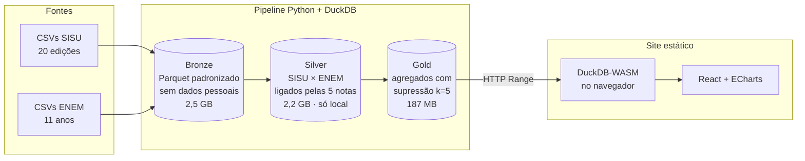

## Contexto

Meu TCC em Engenharia de Computação (UTFPR, Cornélio Procópio, aprovado em 2026) investigou por que
as inscrições no câmpus caíram mais de **84%** entre o semestre de maior e o de menor procura. A
análise original rodava em um script Python com Tkinter e um Power BI alimentado por planilhas Excel,
e cobria um único câmpus.

O SISU Lens leva a mesma análise para **todas as 151 instituições do SISU**, com um pipeline
reprodutível e um painel público que qualquer pessoa abre no navegador.

## O problema de dados

- **Volume:** os CSVs do SISU (20 edições) e do ENEM (11 anos) somam cerca de 60 GB. Não cabem em
  memória com pandas e não dão para servir direto num site.
- **Sem chave em comum:** o SISU diz *onde* a pessoa se inscreveu; o ENEM traz o questionário
  socioeconômico. Por causa da LGPD, o número de inscrição vem mascarado e não liga as duas bases.
- **Privacidade:** a junção das duas bases permitiria reidentificar respostas socioeconômicas de
  pessoas reais. O dado ligado linha a linha não pode ser publicado.
- **Fontes sujas:** encoding cp1252 declarado como latin-1, `;` dentro de campos entre aspas (2020-1),
  linhas corrompidas (2015-1) e códigos de tipo de escola invertidos no ENEM 2018.

## Arquitetura

| Camada | O que contém | Onde fica |
|---|---|---|
| Bronze | Um Parquet por edição/ano, colunas padronizadas, sem nome, CPF, inscrição ou data de nascimento | publicável |
| Silver | Inscrição do SISU ligada ao participante do ENEM | **só local** (LGPD) |
| Gold | Contagens e médias por recorte, com grupos menores que 5 suprimidos | servida ao site (GitHub Pages) |

## Decisões técnicas

| Decisão | Alternativa descartada | Por quê |
|---|---|---|
| Ligar SISU e ENEM pela **combinação das 5 notas** | Nº de inscrição; nome + nascimento | A inscrição é mascarada. As notas são contínuas: no ENEM 2018 só 16 combinações se repetem entre 3,9 milhões de participantes |
| Notas convertidas para inteiro (× 10) antes da junção | Comparar `float` | Evita falso negativo por arredondamento |
| Combinações repetidas viram `ambiguo`, sem perfil | Escolher uma das pessoas | Nunca duplicar nem atribuir perfil errado a uma inscrição |
| **DuckDB** no ETL | pandas | Lê os CSVs direto em SQL, por streaming, sem estourar a memória |
| **Parquet zstd** | CSV, Postgres | SISU 2019-2: 575 MB → 26,6 MB. Colunar, comprimido e legível por HTTP Range |
| **DuckDB-WASM** no navegador | API + banco | Sem servidor para manter nem pagar: o navegador baixa só os blocos do arquivo que o filtro precisa |
| Supressão de grupos < 5 na gold | Publicar a silver | Evita reidentificação (LGPD), documentado em `docs/lgpd.md` |
| Site e gold no **GitHub Pages** (branch `gh-pages`) | Servidor próprio, bucket pago | Gratuito, aceita HTTP Range e mantém os 187 MB de Parquet fora do histórico do código |

## Qualidade e validação

- **Reconciliação com o TCC:** `validar_tcc.py` compara o total de inscrições por edição com a
  Tabela 5 do trabalho. **18 de 20 edições batem exatamente**. 2014 difere em −5 e −2 inscrições, com o
  arquivo de origem íntegro.
- **Taxa de junção monitorada por edição:** mais de 99,5% das inscrições ligadas a um único
  participante em todas as edições.
- **Bugs encontrados no código original do TCC:** um filtro de "1ª chamada" sobrescrito na linha
  seguinte, que duplicava 1ª e 2ª chamadas em 2014, e a confusão entre *linhas* (inscrições, 60.758)
  e *candidatos* (~41.748). Os dois estão corrigidos no pipeline novo.

## Resultados

- O fenômeno não é local: somando todas as instituições, as inscrições caíram de **7,3 milhões
  (2014) para 2,6 milhões (2023), −64%**. A UTFPR tem a 3ª maior queda absoluta do país.
- O painel replica as páginas do Power BI do TCC e acrescenta rankings por instituição e por curso.
  Está no ar em [gabrielcesanto.github.io/sisu-lens](https://gabrielcesanto.github.io/sisu-lens/) e
  também abre [na seção Dashboards](/#sisu-lens).

| Ranking de queda por instituição | Perfil socioeconômico |
|---|---|
|  |  |

## Próximos passos

- Publicar também o bronze sem dados pessoais (Hugging Face Datasets) para quem quiser refazer as análises.
- Orquestrar o pipeline e adicionar testes de dados automatizados (contagens, domínios, unicidade).
- Reavaliar a supressão k=5 em recortes muito finos (renda × UF perde 30% das linhas).
